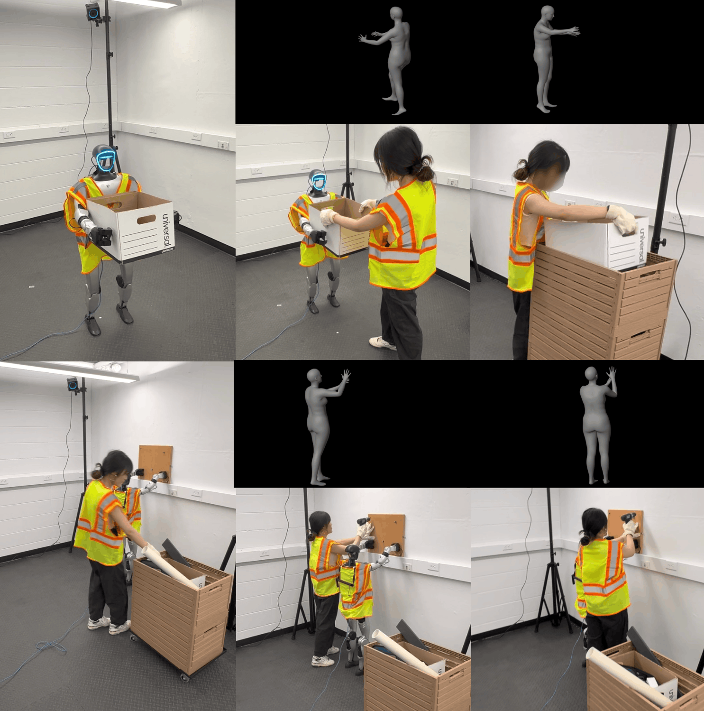
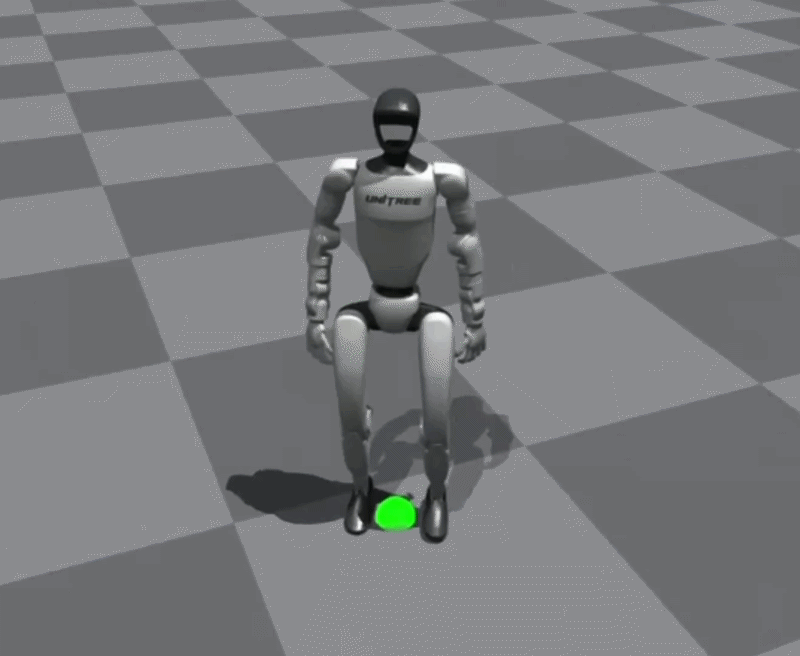
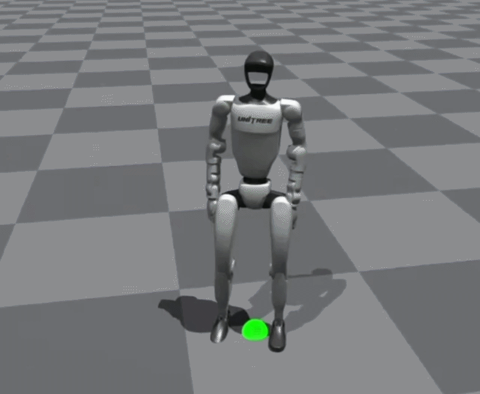
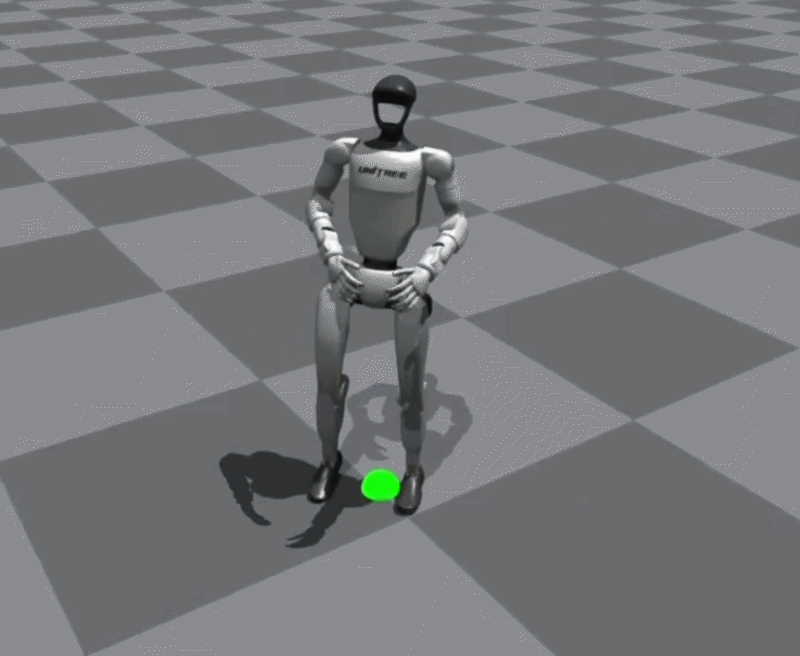
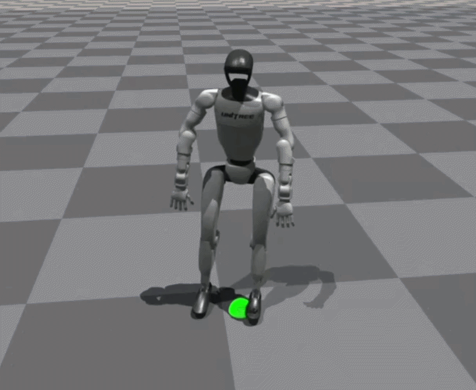
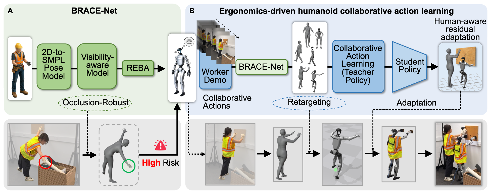

# Pose-aware Human-Humanoid Collaboration in Construction

<p align="center">
  <b>Yanxi Liu<sup>1</sup>, Houtan Jebelli<sup>2</sup>, Yizhi Liu<sup>1</sup></b><br>
  <sup>1</sup>Syracuse University &nbsp; <sup>2</sup>University of Illinois Urbana-Champaign
</p>

<p align="center">
  <a href="https://cici2323.github.io/Pose-aware-human-humanoid-collaboration/"><b>[🌐 Project Website]</b></a>
</p>

<!-- Figure 1 from the accompanying manuscript. -->
<p align="center">
  
</p>
<p align="center">
  
  
  
  
</p>
<p align="center">
  
  
</p>

<p align="center">
  
  
</p>

This is the official repository for **Pose-aware Human-Humanoid Collaboration in Construction**. Our method integrates **BRACE-Net for occlusion-robust human pose reconstruction and ergonomic-risk assessment** with a **teacher-student-adaptation reinforcement learning framework** for learning and executing worker-preferred humanoid assistance.

> **Code release: coming soon.** Code, pre-trained checkpoints, and evaluation scripts are planned for release.

---

## 📦 Release To-Do List

- [x] **Environment Setup**: dependency specifications, simulator setup, and installation instructions.
- [ ] **Data Preparation**: preprocessing for human pose reconstruction, ergonomic assessment, and SMPL-to-humanoid motion retargeting.
- [ ] **BRACE-Net**: training and inference code for visibility-aware pose refinement and REBA-based assessment.
- [ ] **Policy Learning**: teacher-policy training, student-policy distillation, and human-aware residual adaptation.
- [ ] **Pre-trained Models**: checkpoints for BRACE-Net and the teacher, student, and residual policies.
- [ ] **Evaluation**: perception evaluation, Isaac Gym / MuJoCo motion-tracking evaluation, and collaborative-performance analysis.

---

## 📄 Abstract

Humanoid robots hold the promise of becoming versatile physical collaborators that assist people across diverse tasks. In construction, this capability could address productivity and safety challenges by supporting workers during physically demanding operations. However, effective collaboration requires more than independent task execution: robots need to recognize when assistance is needed and coordinate their actions with human partners toward shared goals.

Here, we present **a pose-aware human-humanoid collaboration method** integrating human-state perception with collaborative skill learning and execution. **A deep pose assessment network** assesses workers' ergonomic risk under partial occlusion to identify assistance needs. **A three-stage teacher-student-adaptation reinforcement learning framework** acquires assistance skills from human demonstrations and adapts learned motions to collaborative requirements.

Results from material transportation and panel installation construction scenarios demonstrate that the system enables a humanoid robot to assess workers' ergonomic risks with **98.6% accuracy** and execute collaborative assistance behaviors with an average mean per-joint position error of **86.9 mm**. Humanoid assistance reduces workers' Rapid Entire Body Assessment (REBA) scores by **48.3%**. This method contributes to the development of adaptive humanoid collaborators for more efficient construction work.

<!-- Figure 3 from the accompanying manuscript. -->
<p align="center">
  
</p>

**When to assist.** BRACE-Net combines HybrIK-X pose initialization with visibility-aware SMPL refinement and REBA-based ergonomic assessment. Hysteresis and temporal persistence distinguish sustained ergonomic risk from transient posture fluctuations.

**How to assist.** Worker demonstrations are reconstructed and retargeted to the humanoid, learned through teacher-policy training and student-policy distillation, and adapted through bounded residual corrections to meet the worker's support and workspace requirements.

---

## ⚙️ Installation

## Environment Setup
```bash
conda create -n colla_humanoid python=3.8
conda activate colla_humanoid
pip install pip==24.0 setuptools==59.5.0 wheel==0.41.3
pip3 install torch==1.10.0+cu113 torchvision==0.11.1+cu113 torchaudio==0.10.0+cu113 -f https://download.pytorch.org/whl/cu113/torch_stable.html

git clone https://github.com/cici2323/HHC_Code.git colla_humanoid
cd colla_humanoid
pip install -r requirements/environment.txt

# Download Isaac Gym Preview 4 from https://developer.nvidia.com/isaac-gym
# Extract it into this repository as isaacgym/.
cd isaacgym/python && pip install -e .
cd ../../rsl_rl && pip install -e .
cd ../legged_gym && pip install -e .
cd ..

# Human pose and body-mesh dependencies.
pip install --no-build-isolation chumpy==0.70
conda install -c bottler nvidiacub
export CUDA_HOME=/usr/local/cuda-11.3  # Adjust if the toolkit is installed elsewhere.
export PATH="$CUDA_HOME/bin:$PATH"
export CC=gcc-9 CXX=g++-9
pip install --no-build-isolation --no-deps "git+https://github.com/facebookresearch/pytorch3d.git@v0.6.2"
```

---

## 🗂️ Data Preparation

<details>
<summary><b>Click to expand</b></summary>

The study uses three datasets with complementary roles:

| Dataset | Role in the study |
|---|---|
| **Human3.6M** | Generic human-motion supervision. |
| **HCTL** - Humanoid Construction Task Learning | Construction-specific human motions. |
| **CHOI** - Construction Human-Object Interaction | Human-object interaction sequences for visibility-aware body reconstruction and collaborative motion learning. |

Data preparation covers RGB observations, human/object masks, SMPL body representations, ergonomic annotations, and humanoid reference motions obtained through motion retargeting. Preprocessing scripts and the required file formats will be documented with the release.

**Data access.** As stated in the paper, the complete raw and processed research data are available from the corresponding author upon reasonable request. A small set of sample data is included in this repository to facilitate code testing and demonstration. Please note that these samples represent only a subset of the data used in the study; access to the complete datasets can be requested separately.
</details>

---

<!--## 📥 Pre-trained Models

*Coming soon.* The planned checkpoint release covers the following components:

| Component | Description | Checkpoint |
|---|---|---|
| **BRACE-Net** | Occlusion-robust SMPL reconstruction with visibility-aware refinement for downstream ergonomic assessment. | *Coming soon* |
| **Teacher policy** | Demonstration-based humanoid motion learning with privileged simulation observations. | *Coming soon* |
| **Student policy** | Distilled base controller using proprioceptive history and a retargeted reference motion. | *Coming soon* |
| **Residual policy** | Bounded joint-position corrections for human-aware collaborative adaptation. | *Coming soon* |

The adapted collaborative controller, **`pi_collab`**, combines the frozen **`pi_student`** with the trained **`pi_res`**. It is not a separate controller learned from scratch.

---

## 🎬 Inference

<details>
<summary><b>Click to expand</b></summary>

*Coming soon.* Entry points, configuration files, and executable examples will be added with the release.

### Human-state perception and assistance triggering

Given monocular RGB observations and the human/object masks used by the refinement module, BRACE-Net reconstructs and refines the worker's SMPL pose, computes REBA scores, and monitors sustained ergonomic risk.

The assistance-triggering mechanism combines **hysteresis** with **temporal persistence**. In the study, the activation threshold is an average REBA score of **4**, and the persistence requirement is **4 consecutive time steps** in the high-risk state.

### Humanoid assistance

For a previously learned task, the adapted controller uses the student-policy observations and collaboration-specific context to generate joint-position targets. A low-level proportional-derivative (PD) controller executes these targets on the humanoid.

The demonstrated construction scenarios are **material transportation**, where the robot retrieves and delivers a toolbox, and **panel installation**, where the robot holds and stabilizes a panel while the worker retrieves a drill and completes fastening.

</details>

---
-->

## 🏋️ Training

<details>
<summary><b>Click to expand</b></summary>

The main documentation for the teacher–student adaptation policy has been uploaded. Tutorials on installation and running the training process will be updated soon.

### BRACE-Net

Train the visibility-aware refinement network using human/object unsigned-distance supervision and body-part correspondence labels. The learned geometric and anatomical cues guide refinement of the initial SMPL reconstruction before REBA-based ergonomic scoring.

### Humanoid collaborative policy learning

1. **Teacher-policy training.** Use PPO to learn humanoid actions from retargeted worker demonstrations. The teacher receives privileged simulation observations and is optimized using risk-weighted motion-tracking, stability, and regularization rewards.
2. **Student-policy distillation.** Distill the teacher into a deployable controller using the reference motion and a **10-step history of proprioceptive observations**, without privileged simulation inputs.
3. **Human-aware residual adaptation.** Freeze the student policy and train a residual policy using PPO. Bounded joint-position corrections adapt the learned motion to the worker's desired support positions and occupied workspace.

**Adaptation and evaluation protocol.** Support requirements and workspace observations are collected during preliminary human-humanoid collaboration and used for residual-policy training **in simulation**. During formal physical evaluation, **both the student and residual policies remain fixed**. The residual correction is computed deterministically from the residual policy's latent mean.

</details>

---

## 📊 Evaluation

<details>
<summary><b>Click to expand</b></summary>

*Coming soon.* Evaluation scripts will follow the staged protocol reported in the paper:

1. **Perception and ergonomic assessment**: SMPL reconstruction MPJPE and per-vertex error (PVE), together with five-level REBA classification accuracy on manually annotated test samples.
2. **Humanoid action generation**: teacher and student motion-tracking MPJPE and stable execution in Isaac Gym and MuJoCo using the same G1 configuration.
3. **Physical collaboration**: ergonomic-risk detection, collaborative task completion, humanoid motion-tracking MPJPE, and changes in worker REBA scores. The student-only controller is also compared with the adapted collaborative controller.

**Motion fidelity is not the sole measure of collaboration.** Residual adaptation may increase deviation from the retargeted demonstration while improving task-relevant support and reducing the worker's ergonomic demands.

### Reported perception results

| Metric | BRACE-Net |
|---|---:|
| SMPL reconstruction MPJPE | **58.9 mm** |
| SMPL reconstruction PVE | **68.3 mm** |
| REBA action-level classification accuracy | **98.6%** |

REBA classification accuracy measures agreement with manual annotations on **500 HCTL and CHOI test samples**. It is distinct from the trial-level ergonomic-risk detection rate below.

### Reported Sim2Sim results

| Policy | Isaac Gym MPJPE | MuJoCo MPJPE |
|---|---:|---:|
| Teacher | 74.2 mm | 72.9 mm |
| Student | 79.6 mm | 80.3 mm |

These results correspond to the teacher-student motion-learning stage reported in Table 1 of the paper.

### Reported physical collaboration results

| Task | Risk detection | Task completion | Motion MPJPE | REBA: human-only / assisted |
|---|---:|---:|---:|---:|
| Material transportation | 100% (10/10) | 80% (8/10) | 86.3 mm | 5.2 / 2.9 |
| Panel installation | 100% (10/10) | 100% (10/10) | 87.5 mm | 6.8 / 3.3 |

The formal physical evaluation involved **five participants**, each completing **two trials per task**, for **10 trials per task**. The physical motion-tracking results summarize successful collaborative executions. Across the two tasks, the paper reports an average MPJPE of **86.9 mm** and a **48.3% reduction in worker REBA scores**.

**Scope and limitations.** These results were obtained in controlled laboratory settings. The two unsuccessful material-transportation trials involved loss of object grasp or whole-body instability during loaded interaction. The reported results should not be interpreted as evidence of deployment readiness across unconstrained construction sites.

</details>

---

## 📚 Citation

Citation information and a formatted BibTeX entry will be added with the public paper link.

---

## 📬 Contact

For questions or reasonable requests for research data and code, please contact Dr. **Yizhi Liu** at [yliu580@syr.edu](mailto:yliu580@syr.edu).
